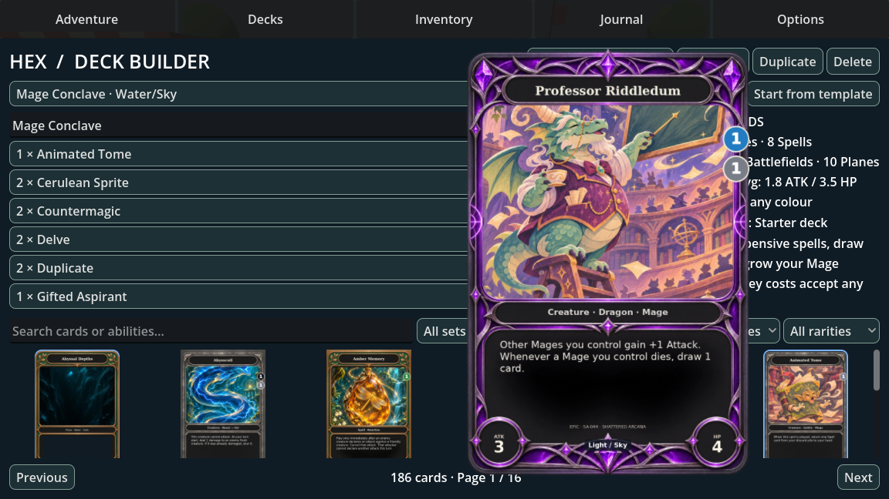

> Historical resource-system analysis. Current rules use free plays and 20-card decks; see [current rules](../hex-planes.md).

# Archetype identities and flexible costs

This change implements coherent casting identities across the whole card pool. Total casting prices, stats, rules, terrain compatibility, random draws, deck sizes, Plane generation and Exposure are unchanged. 65 cards change their colour requirements or split an existing price into matching and generic Power.

## How mixed costs work

A grey cost circle accepts Power of any colour. It is a payment allowance, not a seventh Power colour: Planes still generate only their printed terrain colours. Coloured requirements must be satisfied first, and every sphere can be spent once. Split spheres remain one flexible Power, not two. Automatic payment preserves flexible spheres when single-colour Power can cover the cost, and favours keeping colours needed by other cards in your hand when paying generic costs.

Examples:

| Card | Applied cost | Purpose |
|---|---|---|
| Professor Riddledum | 1 Water + 1 any colour | Core Mage support |
| Seer of the Realms | 1 Sky + 1 any colour | Spell/draw engine |
| Orator of the Void | 1 Sky + 2 any colour | Mage finisher |
| Gobskin Sympathizer | 1 Earth + 1 any colour | Goblin/Wiskin bridge |
| Realmskipper / Animated Tome | 1 any colour | Neutral Goblin/Mage bridges |
| Bullseye Brothers | 2 Earth + 1 any colour | Focused damage payoff |
| Loriadre | 2 Light + 1 any colour | Focused Light finisher |

Cerulean Sprite stays 1 Water. Powerful specialised cards can retain two matching requirements; ordinary two-cost cards generally need one matching colour and one generic payment. Small neutral utility equipment can be paid entirely with generic Power.

## Practical build-around combinations

Choose an archetype in the Hex deck builder and click **Start from template**. This starts a new draft; Save or Use for battles uses the existing save flow. It never overwrites another saved deck or changes the current battle deck automatically. All templates contain 30 cards and ten Planes.

| Archetype | Core colours | Plan |
|---|---|---|
| Goblin Horde | Fire / Earth | Build a board quickly, then rally Goblins and convert deaths into cards. |
| Wiskin Guard | Earth / Light | Protect lanes, share formation bonuses and recover after combat. |
| Mage Conclave | Water / Sky | Chain inexpensive spells, draw cards and grow your Mage engines. |
| Grave Circle | Dark / Water | Recycle creatures and spells while wearing down the enemy. |
| Storm Wings | Sky / Fire | Use fast threats, protected back-rank pressure and amplified spell damage. |
| Grove Kin | Earth / Water | Survive combat, heal your board and grow through repeated exchanges. |
| Shadow Veil | Dark / Sky | Disrupt targets and hands, then exploit exposed lanes. |
| Dawn Court | Light / Sky | Shield allies and support an aerial formation. |
| Blood Coven | Fire / Dark | Turn sacrifice, death triggers and Goblin attacks into pressure. |
| Sacred Tide | Water / Light | Sustain a defensive board while drawing into stronger answers. |
| Pathfinders | Earth / Sky | Use equipment, swaps and backline access to control positioning. |
| Grave Roots | Earth / Dark | Combine durable growth with sacrifice and creature recovery. |
| Twilight Host | Dark / Light | Trade creatures, recover fallen allies and protect your finishers. |
| Ash Current | Fire / Water | Mix burst damage and healing with tempo and card flow. |
| Sunforge | Fire / Light | Equip aggressive bodies, then protect them through decisive attacks. |
| Water Mages | Water | A single-colour spellcraft core with generic costs and neutral Mage bridges. |

These cover all fifteen two-colour combinations plus mono-Water Mages. They are starting points, not restrictions on deck construction or claims that all pairs have equal win rates.

## Tribal and supporting packages

- **Goblins: Fire/Earth.** Every printed Goblin now fits that core or is a generic bridge. Fire supports aggression, death value and rally effects; Earth supplies pressure and bodies. Fire/Dark remains an intentional sacrifice variant.
- **Wiskins: Earth/Light.** Their printed creatures fit Earth/Light, including Rhodovan, Gobskin, Bullseye Brothers and Cloudcarriage Captain. Earth supports formation and positioning; Light adds shields, recovery and leadership.
- **Mages: Water/Sky.** Water supports card flow and growth; Sky supplies manipulation, counters and spell damage. The basic Mage package no longer requires splashing Light, Dark and Fire just to assemble its engines. Necromantic Bonecaller remains Dark and Goblin tribal casters can remain Fire as optional variations.
- **Graveyard: Dark/Water or Earth/Dark.** Dark provides sacrifice, recursion and removal; Water offers draw and tempo while Earth supplies a durable board.
- **Equipment:** generic Compass, Satchel, Shackles and Ring utility can cross colours. Named elemental equipment and specialised payoffs retain coloured anchors, so equipment decks still make identity choices.

A two-colour Mage deck can include Professor, Recluse, Seer, Orator, Sprite, Delve, Countermagic, Duplicate, Mirror Plate and Arcane Amplifier without separate Light/Dark/Fire Power. Its total card costs remain unchanged; matching pips are reduced rather than the cards becoming free.

Terrain compatibility is still separate. A Water-cost Mage may favour Earth/Dark terrain. Preserve suitable natural hexes or choose compatible Planes when placing creatures. Off-colour Power can now pay the generic portion of a cost, making those terrain choices less wasteful. The templates are tested in the neutral arena, not every RPG biome.

## Existing and enemy decks

Saved player decks remain intact. After changed anchors, adjust their Planes or start with an updated template. The deck builder lists missing Power colours when its Plane sources cannot cover a required anchor. It does not silently replace your cards.

All 28 enemy decks have matching resource bases; twelve lists are realigned where Mage/support anchors changed. Their cards retain two-colour requirements after excluding generic costs. Old 20-card deck migration ignores generic payments when choosing which Plane colours to add.

## Validation

- 96 real seeded matches: every template against two enemy decks with three seeds each. All complete under the live tactical AI, with normal random draws and existing optional redraws.
- Native tests cover mixed/neutral/specialised payments, dual-sphere conservation, preserving flexible Power, finish equality, all colour pairs, mono-colour Mages, tribal anchors and enemy Plane coverage.
- UI checks cover template creation, saved-deck preservation, selecting the template for battle, missing-source warnings and actual grey/Water cost pixels.
- The movement/equipment template exposed a pre-existing Silkstep Sandals failure when a swapped creature bounced off incompatible terrain. The effect now stops applying its buff after the target leaves play; a regression covers this.

These checks establish playable costs and coherent requirements. They do not establish final competitive balance: opponent tiers, custom combinations and biome-specific placement still need playtesting.

## Complete requirement changes

| Card | Previous | Applied |
|---|---|---|
| LT-002 Amberstinger | 2 Earth | 1 Earth + 1 any colour |
| LT-003 Abysscoil | 2 Dark | 1 Dark + 1 any colour |
| LT-006 Gym Mouse | 2 Earth | 1 Earth + 1 any colour |
| LT-007 Ashwing | 2 Fire | 1 Fire + 1 any colour |
| LT-008 Amethyst Colossus | 2 Dark | 1 Dark + 1 any colour |
| LT-012 Aurora Stag | 2 Light | 1 Light + 1 any colour |
| LT-015 Cloud Sovereign | 2 Sky | 1 Sky + 1 any colour |
| LT-016 Cindermaw | 2 Fire | 1 Fire + 1 any colour |
| LT-020 Crystal Gale | 2 Sky | 1 Sky + 1 any colour |
| LT-024 Coralcrusher | 2 Water | 1 Water + 1 any colour |
| LT-026 Glacier Cube | 2 Water | 1 Water + 1 any colour |
| LT-030 Crownless Lich | 3 Dark | 2 Dark + 1 any colour |
| LT-042 Sunken Compass | 1 Water | 1 any colour |
| LT-051 Lantern Tortoise | 2 Light | 1 Earth + 1 any colour |
| LT-055 Wayfarer Satchel | 1 Earth | 1 any colour |
| LT-060 Cloud Kingdom | 2 Sky | 1 Sky + 1 any colour |
| SA-002 Zap | 1 Fire | 1 Sky |
| SA-008 Mind Control | 3 Dark | 1 Water + 2 any colour |
| SA-010 Duplicate | 2 Sky | 1 Sky + 1 any colour |
| SA-015 Suffer the Dead | 2 Dark | 1 Dark + 1 any colour |
| SA-018 Spring to Life | 2 Light | 1 Light + 1 any colour |
| SA-020 Set the Trap | 2 Earth | 1 Earth + 1 any colour |
| SA-021 Fade to Nothing | 2 Dark | 1 Dark + 1 any colour |
| SA-023 Disruption Pact | 2 Dark | 1 Dark + 1 any colour |
| SA-024 Vanguard | 2 Light | 1 Light + 1 any colour |
| SA-025 Control the Future | 2 Water | 1 Water + 1 any colour |
| SA-026 In Fate's Hands | 2 Dark | 1 Dark + 1 any colour |
| SA-027 Begin Anew | 2 Sky | 1 Sky + 1 any colour |
| SA-028 Search the Archives | 2 Sky | 1 Sky + 1 any colour |
| SA-029 Decimate | 3 Dark | 2 Dark + 1 any colour |
| SA-030 Spellproof Cowl | 1 Light | 1 Sky |
| SA-031 Mirror Plate | 2 Sky | 1 Sky + 1 any colour |
| SA-033 Arcane Amplifier | 2 Fire | 1 Sky + 1 any colour |
| SA-036 Realmskipper | 1 Sky | 1 any colour |
| SA-037 Mystical Woolie | 1 Light | 1 Water |
| SA-039 Animated Tome | 1 Dark | 1 any colour |
| SA-040 Feverish Academic | 1 Fire | 1 Sky |
| SA-043 Seer of the Realms | 2 Sky | 1 Sky + 1 any colour |
| SA-044 Professor Riddledum | 2 Light | 1 Water + 1 any colour |
| SA-045 Soultorn Recluse | 2 Dark | 1 Water + 1 any colour |
| SA-046 Rhodovan | 2 Earth | 1 Earth + 1 any colour |
| SA-047 The Orator of the Void | 3 Dark | 1 Sky + 2 any colour |
| WE-011 Burrowborn Magikitten | 2 Dark | 1 Earth + 1 any colour |
| WE-014 Makeshift Battering Ram | 2 Earth | 1 Earth + 1 any colour |
| WE-015 Gobskin Sympathizer | 2 Fire | 1 Earth + 1 any colour |
| WE-018 The Bullseye Brothers | 3 Earth | 2 Earth + 1 any colour |
| WE-020 Edelberry Burrow | 2 Earth | 1 Earth + 1 any colour |
| WE-021 The Vicious Maw | 2 Fire | 1 Fire + 1 any colour |
| WE-022 Goblin Totem | 2 Dark | 1 Fire + 1 any colour |
| WE-024 Urkjaw Bloodfist | 2 Fire | 1 Fire + 1 any colour |
| WE-025 Royal Knight Eklo | 2 Light | 1 Light + 1 any colour |
| WE-026 Fireback Rider | 3 Fire | 1 Fire + 2 any colour |
| WE-027 Cloudcarriage Captain | 3 Sky | 1 Light + 2 any colour |
| WE-028 Obelisk of Fis'Duum | 3 Dark | 2 Dark + 1 any colour |
| WE-029 Shackles of Nim | 1 Dark | 1 any colour |
| WE-030 Champion's Tunic | 2 Light | 1 Light + 1 any colour |
| WE-032 Torn Banner | 2 Earth | 1 Earth + 1 any colour |
| WE-033 Ring of Disassociation | 1 Sky | 1 any colour |
| WE-040 Back in Action | 2 Light | 1 Light + 1 any colour |
| WE-043 Level the Field | 2 Dark | 1 Dark + 1 any colour |
| WE-044 Raise the Dead | 3 Light | 1 Dark + 2 any colour |
| WE-045 Loriadre, Angel of War | 3 Light | 2 Light + 1 any colour |
| WE-046 Enrapture | 2 Light | 1 Light + 1 any colour |
| WE-047 Seraphim Scepter | 3 Dark | 2 Dark + 1 any colour |
| WE-049 Momentary Allegiance | 3 Dark | 1 Dark + 2 any colour |

## Rebuild and reproduce

```sh
python tools/cards/render_cost_badges.py
python tools/hex/build_engine.py
node tools/hex/validate_archetypes.cjs
godot --headless --path . --script res://Tests/Hex/archetype_test.gd
godot --headless --path . res://Tests/Hex/Archetypes.tscn
```

The cost overlays are shared across regular, full-art and Illustration Rare versions. Source archetypes are in `Resources/Hex/Data/archetypes.json`.


