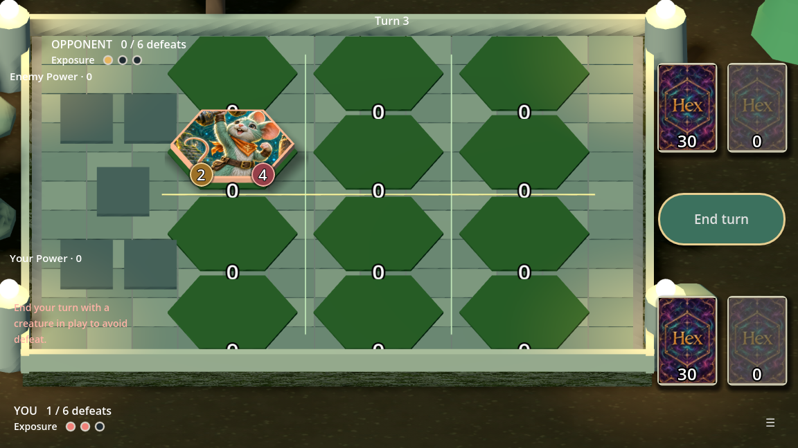

# Exposure and creature defeats

A Standard battle can be lost by either condition independently:

- Six non-Summon creature deaths under the existing defeat-count rules.
- Three Exposure counters.

At the end of your own turn, after sacrifices, regeneration and queued end-of-turn
triggers resolve:

| Final field state | Your Exposure |
|---|---|
| You have at least one creature | Reset to zero |
| You are empty; opponent has a creature | Increase by one; lose at three |
| Both sides are empty | Hold the existing count |

Only the ending player's counter is checked. Opponent turns do not advance your
counter. There is no additional opening grace period, change to card draws,
resource generation or casting costs. An exposed opening gets two warnings before
the third qualifying empty end loses the game. The three counts are consecutive
qualifying ends since your last turn ending with a creature; both-empty ends pause
rather than clear that streak.

A surviving Summon holds the field and resets Exposure like any other creature.
A Doomed Summon sacrificed at turn end has already left before the check and cannot
reset it. Summon deaths still do not count toward the six-death limit. Exposure
never increments creature deaths or triggers death abilities.

Both players have three small Exposure markers beside their separate death count.
Two counters show a red warning when the opponent has a creature. The warning uses
“your turn” while you are active and “your next turn” during the opponent's turn.
Three filled markers and the match result explain an Exposure defeat. Marker
hover text explains the reset and both-empty rules.

Existing match saves without an Exposure field start at zero; no previous turns
are inferred. New saves preserve each counter. Unsupported negative, fractional or
out-of-range values are rejected. The tactical AI values reducing Exposure and uses
the same end-of-turn evaluation as the player; it can deploy an affordable creature
rather than accepting a third-counter loss.

Native regression coverage includes first/second/third qualifying ends, opponent
turns, independent counters, recovery, both-empty pauses, persistent and Doomed
Summons, queued end triggers, the six-death condition, saved state and AI rescue.
UI tests exercise the real markers, warning, defeat result and recovery. Run:

```sh
godot --headless --path . --script res://Tests/Hex/exposure_test.gd
godot --headless --path . --script res://Tests/Hex/exposure_ui_test.gd
```


