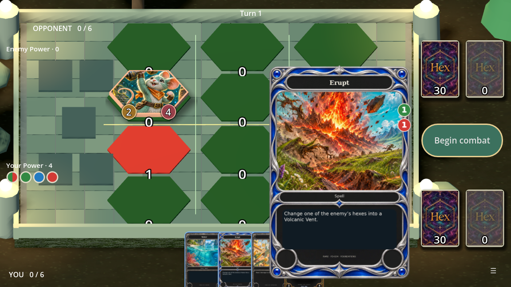

# Planes and Power

Standard decks contain 30 cards. Basic Earth, Sky, Fire, Water, Dark and Light
Planes have no per-card copy cap beyond deck size. Every other card keeps its
existing limit (normally two, with Loriadre limited to one). Cosmetic finishes
share costs, compatibility and limits. Volcanic Vent is generated, not deckable.

The turn sequence is Draw → Power → Pre-combat → Combat → Post-combat → End.
The first player still skips their first draw. Power generation automatically
clears only the active player's old pool and produces one sphere per Plane level.
The Power phase pauses for an optional Plane placement; Continue enters the main
phase. A Plane may also be played in either main phase, sharing the same allowance
of one Plane card per owner turn. Planes cannot normally be played during combat
or the opponent's turn. Cards placed by explicit effects do not consume this
hand-play allowance or grant on-play Power unless the effect says so.

Every Plane card is free and produces one matching Power immediately on hand-play.
A matching terrain set increases the hex's level by one. A different set replaces
its terrain and resets its level to one. Only the newly played card's one sphere
is added immediately; upgrades do not regenerate the entire hex. Existing Power
is retained even when a hex changes, through the opponent's turn, until the owner's
next Power phase. This allows Reactions and Ambush to spend saved Power.

Dual terrain spheres are split in the UI and pay either colour once. Payment
finds a valid assignment, preferring single-colour spheres where possible; it never
spends the same sphere twice. An illegal or unaffordable action spends nothing.
Cards placed by effects bypass casting costs, but obey creature compatibility.

Natural terrain is level zero: it supports creature compatibility and terrain
interactions but produces no Power. A neutral practice arena starts with one hex
of each terrain per side. EncounterData exposes six `hex_terrains` and
`locked_hexes`, mirrored to both sides at level zero. Forest/meadow environments
use Earth under the current six-terrain vocabulary. A locked hex may gain matching
levels but cannot be replaced, including by Erupt.

Creatures print their allowed terrain types separately from their Power cost.
They may occupy a hex matching either allowed terrain, at any level. If a move,
control change or Plane replacement leaves a creature incompatible, it returns
to its original owner's hand without counting a defeat. Summons are removed from
the game instead. Attachment cleanup follows the existing return-to-hand rules.
A hex has one active Plane identity/effect: playing another matching Plane keeps
the level progression but replaces that identity. Plane abilities do not stack.

Sacred Spring heals its occupant at its controller's pre-combat phase. Volcanic
Vent damages its occupant then. Wall of Light shields the friendly creature
directly behind it at the opponent's combat start. Door to Ashgar summons a Goblin
Punk into its empty hex at its owner's combat start, with Sprint and Doomed. Doomed
uses the existing end-of-turn sacrifice rule. Erupt costs one Earth and one Fire
and replaces an unlocked enemy hex with a level-one Volcanic Vent; it grants no
immediate Power. Subsequent generation belongs to that hex's controller.

## Initial balance and presentation

All 160 existing cards have explicit initial costs, and every creature has allowed
terrain types. Costs primarily follow attack/HP, entry effects, repeatable value,
removal efficiency and major board swings. Small tactical spells cost 1–2;
each colour has a one-Power creature option; midrange creatures and engines generally cost 3–4; large swings cost 5–7. Existing
printed stats and effects are retained. This is an initial cost curve requiring
playtesting, not a claim of final balance. The empty-field defeat rule is unchanged:
a resource-starved opening can still lose when the opponent establishes a board.

The starter is an Earth/Light build. All 28 enemies have explicit 30-card two-colour
lists with ten Planes in `power-enemy-decks.json`. Tactical AI uses the same legal
payment and placement checks, values Plane development and accounts for terrain
bounces. Old 20-card saved builds gain ten matching Planes when loaded. Legacy
match saves migrate to zero-level natural terrain, empty Power pools and ten
additional Planes shuffled into each remaining deck. Occupied legacy hexes receive
compatible natural terrain so migration does not bounce the existing board.

Costs appear as numbered circles at the right edge of all card finishes: Earth
green, Fire red, Water blue, Sky yellow, Dark black, Light white. Transparent cost
and creature compatibility overlays are built by `tools/cards/render_cost_badges.py`
and composited when loading textures. Original images remain intact. Export presets
include the overlays. Rebuild after editing costs in `cards.json`.

Run `python tools/hex/build_engine.py` after rules/data changes. Native QuickJS tests
in `planes_test.js` cover actual payment, generation, special Planes, compatibility,
save migration and deck rules. Existing ability fixtures provide explicit resources
to isolate their effects; full-match simulations use real shuffled decks and costs.
