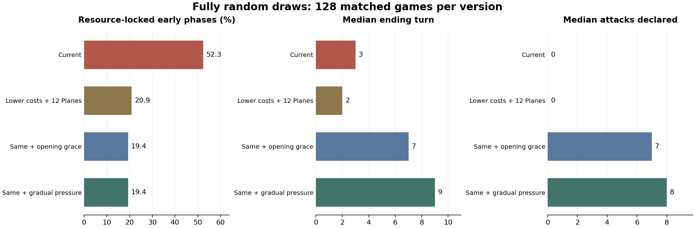

# Random-draw battle flow: costs and Plane density

**Opening hands and subsequent draws remain fully random from the mixed deck. There is no card-for-Plane exchange, guaranteed opening resource, separate Plane pile or draw smoothing in these experiments.** Existing optional whole-hand redraws also remain random.

No live gameplay files were changed. The harness mutates only isolated in-memory copies of the engine and card data.

## Findings

The user's diagnosis is substantially supported: costs and resource density are restricting participation. Across all 28 opponents, lowering costs and increasing Planes from 10 to 12 reduced resource-locked early main phases from **45.0% to 19.1%**. Early idle turns fell from **53.3% to 22.8%**, and the median game increased from three turns with zero attacks to four turns with two attacks.

There is a separate defeat-rule interaction. With the combined changes but instant empty-field defeat retained, **48.1%** of the broader sample still ended by turn 3, versus **63.8%** in the current rules. The smaller eight-archetype pilot remained harsher (63.3% early endings), illustrating why a limited subset should not determine individual deck rankings. Improved resource access helps substantially, while an instant empty-field defeat still amplifies draw variance.

## Matched comparisons

| Version | Games | Median ending turn | End by turn 3 | Resource-locked early main phases | Median attacks |
|---|---:|---:|---:|---:|---:|
| Current costs, 10 Planes | 128 | 3 | 61.7% | 52.3% | 0 |
| Lower costs, 10 Planes | 128 | 3 | 59.4% | 28.8% | 1 |
| Current costs, 12 Planes | 128 | 2 | 74.2% | 46.8% | 0 |
| Lower costs, 12 Planes | 128 | 2 | 63.3% | 20.9% | 0 |
| Lower costs, 14 Planes | 128 | 4 | 49.2% | 21.3% | 2 |
| Lower costs, 12 Planes, opening grace | 128 | 7 | 0.0% | 19.4% | 7 |
| Lower costs, 12 Planes, gradual pressure | 128 | 9 | 0.0% | 19.4% | 8 |

Each pilot row contains 128 matches: eight enemy archetypes × sixteen starting seeds. All rows use the same initial seeds. Reported turns are full-rotation/displayed turn numbers, not alternating player actions. An attack means a legal attack declaration, which may subsequently be cancelled or prevented.

## Wider validation

| Version | Games | Median ending turn | End by turn 3 | Resource-locked early main phases | Median attacks |
|---|---:|---:|---:|---:|---:|
| Current costs, 10 Planes | 896 | 3 | 63.8% | 45.0% | 0 |
| Lower costs, 12 Planes | 896 | 4 | 48.1% | 19.1% | 2 |

Each wider row uses every one of the 28 preconstructed enemies and 32 starting seeds, for 896 games. The player uses the current Earth/Light starter throughout. These are functional pacing comparisons, not evidence that every custom deck or individual card is balanced.

## Recommended next changes

1. **Reprice cards downward, card by card.** Put ordinary early creatures and modest utility within one Power, most midgame cards around two or three, and reserve four-plus costs for substantial swings or engines. The diagnostic discount reduced each monocolour non-Plane cost above one by one Power, with a floor of one. This demonstrated direction, not a recommendation to ship a blanket discount: a strong Ward creature and a conditional utility creature may still deserve different prices. Multi-terrain costs such as Erupt's Earth + Fire were unchanged. No generic or new Power type was introduced.
2. **Try 12 Planes / 18 battle cards in 30-card decks.** Keep all draws random and retain one Plane play per turn. The Plane-density tests replace expensive non-creature support cards first, then expensive creatures if required, with basics in the same two colours. They therefore represent practical deck-building packages, not a pure draw-probability intervention. Fourteen Planes is also tested, but lowers battle-card density further; start with twelve and measure flooding in human play.
3. **Give the opening a recovery window.** The smallest tested defeat-rule adjustment leaves the existing empty-field loss intact but starts it at turn 5, giving each side four opening turns. Combined with lower costs and twelve Planes, this reached a median ending turn of seven with seven attacks, versus three and zero in the matched baseline. Creature-defeat losses still apply during this opening window. This does not guarantee resources or prevent a genuinely losing battle; it prevents a single early creature from ending a game before resource development.
4. **If later recovery still feels too harsh, consider gradual pressure separately.** The tested alternative exempts the first two turns from empty-field pressure; from turn three, an empty field opposite an occupied one adds one defeat counter rather than causing instant defeat. Six total counters still lose. That variant reached nine turns and eight attacks in the pilot. It is a larger rules change, and the UI would need to distinguish pressure counters from actual creature deaths. It is an option, not a resource-access rule or an implemented change.
5. **Rebuild curves and recalibrate opponent difficulty afterward.** Keep enough cheap creatures to defend an opening, rather than counting cheap Equipment as early board presence. The current starter has 18 of 20 battle cards costing 1–2 and 12 cheap creatures. Crown Imperium has only 3 cheap creatures and 7 cards costing 5+. These decks were not adequately adapted from the free-card system. AI mulligans should assess resource counts and castable costs, while continuing to draw fully random replacement hands.

Under random draws, bad hands cannot be eliminated. The goal is to make a low-resource hand less common and give it usable plays and time to recover, rather than bypassing the randomness.

## Exact Plane probabilities

Before mulligans or bonus card draws, a 30-card deck with ten Planes has a **44.9%** chance of opening with zero or one Plane. The first player sees nine cards by their fifth turn: opening five plus four normal draws. The probability of still having at most one Plane is:

| Planes in 30 cards | At most one in opening five | At most one in first nine cards |
|---|---:|---:|
| 10 | 44.9% | 10.0% |
| 12 | 31.8% | 4.0% |
| 14 | 20.9% | 1.3% |

These are exact combinatorial probabilities, not estimates from the match sample. Conditional costs, colour mismatches and creature placement can still make a hand unplayable even with two Planes.

## Definitions and limits

- **2,432 distinct variant/enemy/seed matchups** are retained. Pilot pairings repeated in the wider validation must produce identical outcomes; the summarizer checks this and does not count them twice.
- A resource-locked phase has at least one non-Plane card in hand but none has an affordable Power cost at the first pre-combat main-phase observation. Target and placement restrictions can block additional cards.
- An idle owner turn has no non-Plane hand play, attack declaration or activated ability. Plane-only setup counts idle. Early rates use rounds 1–3 while games remain running, so rates are conditional on observed turns rather than projections for games already ended.
- Both sides use the existing tactical AI, real card effects and neutral mirrored terrain. Experimental costs and defeat rules also apply inside AI search. The player redraws a resource-poor or creatureless hand once; the bot retains its shipped creature-count policy. All replacements are whole-hand random redraws, never selected cards.
- The density variants retain 30-card decks and all six existing Power colours. Card stats, ability text, compatibility and the one-Plane-per-turn allowance remain unchanged. There are no new card-exchange actions or guaranteed resources.
- Limits are 25 full turns or 1,800 actions. Unfinished matches are censored, not declared victories or draws. Per-variant censoring and error counts are in summary.json.
- Pacing and participation are not proof of enjoyment or competitive balance. Human playtests, custom-deck coverage, biome layouts and a card-specific pricing pass are still needed.
- Reference engine SHA-256: `9e4e354b7f40f1eb3e6e477394145d4117711a3f02fddea1dd6606379059133e`.

## Reproduce

Run from the repository root with Node 22+ and Python 3.12+:

```sh
node tools/hex/analysis/simulate_flow.cjs current 32 25 all
node tools/hex/analysis/simulate_flow.cjs cheaper_planes12 32 25 all
```

For each pilot variant listed in the script, use `16 25` and omit `all`. The eight-archetype baseline is also an exact subset of the wider baseline. Then run:

```sh
node tools/hex/analysis/audit_curves.cjs
python tools/hex/analysis/summarize_flow.py
python tools/hex/analysis/write_flow_report.py
```

Raw logs are preserved as compressed JSON; the summarizer also accepts uncompressed regenerated logs. `--archive` compresses them after validating duplicate outcomes and errors. The optional report flag `--plot` uses Matplotlib 3.10.8 to regenerate comparison.png and comparison.svg.


