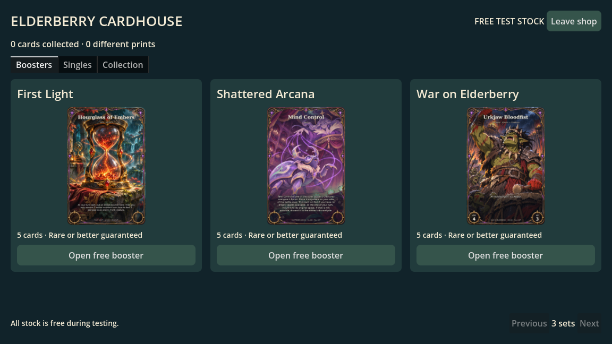
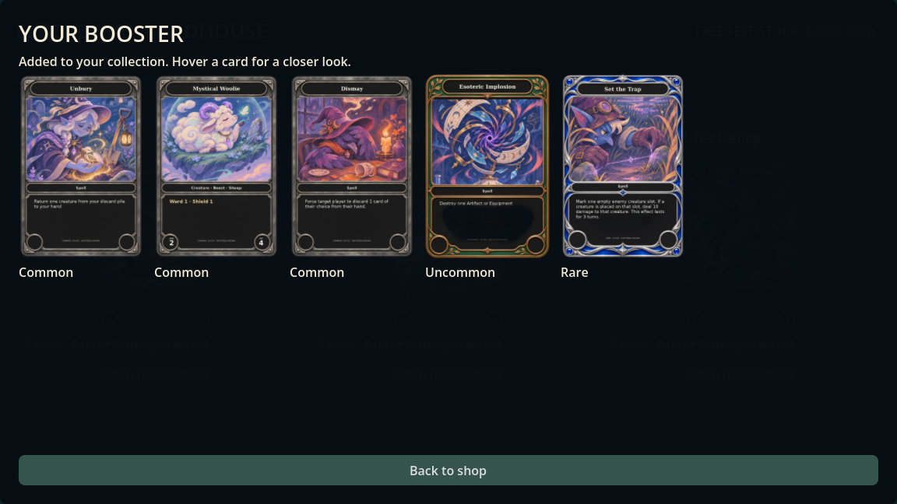

# Meadow card shop

Walk up to the shopkeeper in front of the market stall and use Interact/Accept.
The existing proximity bubble and interaction handler open Elderberry Cardhouse.

All stock is free during testing. No currency or battle coin rewards are added.

- **Boosters:** choose First Light, Shattered Arcana or War on Elderberry. Each
  booster grants three Common cards, one Uncommon and one Rare-or-better card from
  that set. Cosmetic full-art and illustration-rare upgrades can appear.
- **Singles:** search by name, select a set and choose regular, full-art or
  illustration-rare prints. Take as many copies as needed for testing.
- **Collection:** review collected prints and quantities, or return one copy.
- Hover a card for a full-size art preview. Escape dismisses a booster reveal
  first; Escape again or Leave shop restores exploration.

The collection records shop acquisitions. All cards remain available in the deck
builder, and cosmetic prints use their underlying card's existing rules.

ShopManager owns catalog lookup, booster generation and collection changes.
Transactions persist to `user://dagam-shop-v1.json` before reporting success and
roll back if writing fails. Shared game saves include the collection; loading an
older save without shop data preserves the current collection. The shop closes
on battle opening, save loading and scene changes, and blocks menu hotkeys while
open so UI interaction locks cannot stack accidentally.

`Scenes/Shopkeeper.tscn` uses the existing Interactable contract. ShopUI remains a
UIBase screen managed through the existing UI stack. The meadow builder includes
the interactive shopkeeper scene, so rebuilding the meadow preserves the shop.

Validation: `Tests/Player/Shop.tscn` covers actual interaction, free stock,
rarity guarantees, cosmetic prints, search, reveals, returns, persistence/restart,
failed-write rollback and shop/menu/battle/scene lifecycle.

