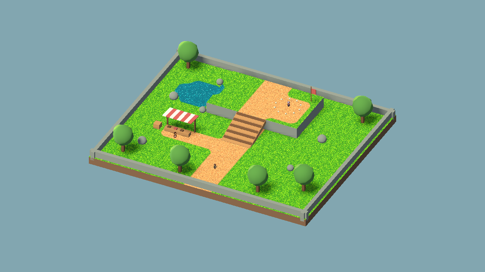

# Meadow test scene

Run the project (F5) or open `Scenes/TerrainTest.tscn` to explore the new small
terrain test area. The entry scene keeps the existing World/Player/SceneRoot
architecture and selects `Scenes/Environments/MeadowTest.tscn` with its PlayerSpawn
marker. `Scenes/Root.tscn` still opens the original test area, including Farmer's
recruitment quest, for existing saves and regression fixtures.

The meadow contains seamless grass/path terrain, a pond, trees, rocks, a striped
market stall and a raised training clearing. A wooden ramp connects the lower
meadow to the clearing. Gravity, a rounded player collider and floor snapping keep
the character grounded while ascending and descending; movement remains cardinal.
Stepping off a ledge clears horizontal velocity and disables air steering until
landing. A flat-bottomed round collider prevents sideways edge-recovery drift.

Interact with the shopkeeper in front of the stall to open the [free testing
card shop](../shop/shopkeeper.md). The rival is an Enemy Area3D using the existing
battle/return logic. Touching the rival starts
a Standard Hex encounter with the Thornbound deck and the selected player deck.
Victory awards 20 XP and removes the rival from the current scene. Defeat or flee
restores exploration and leaves the rival available after its 15-second cooldown.

Edit the placed nodes directly in MeadowTest.tscn, or rebuild the initial authored
layout with `python tools/terrain/build_meadow_scene.py`. Rebuilding overwrites that
scene, so incorporate any manual edits into the builder before rerunning it.

The regression `Tests/Player/Meadow.tscn` exercises spawn grounding, actual ramp
traversal, collision-triggered battle, defeat/rematch, victory/XP and control
restoration. Existing Farmer/save and encounter regressions remain on the original
Root scene.
